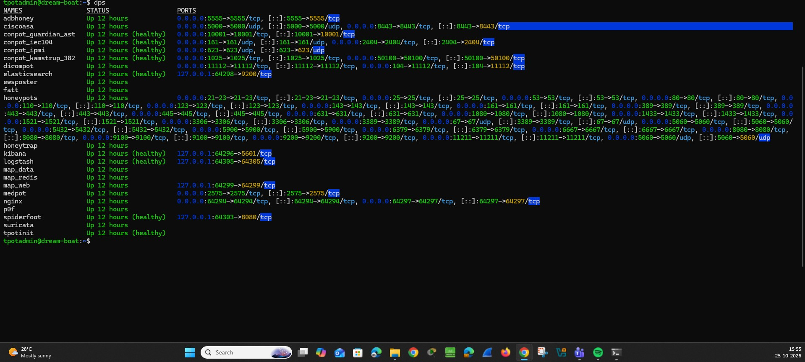
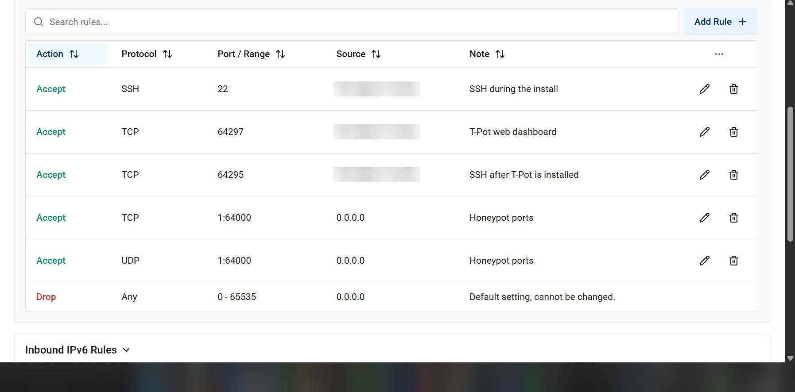
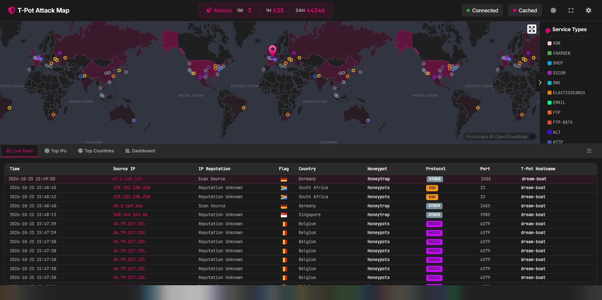
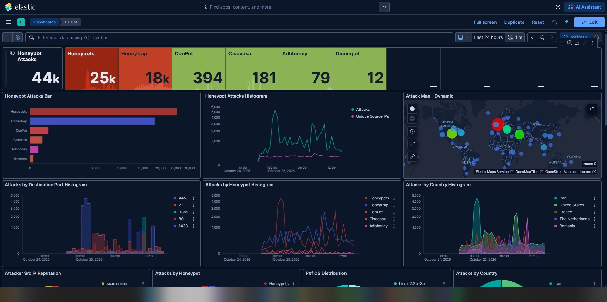
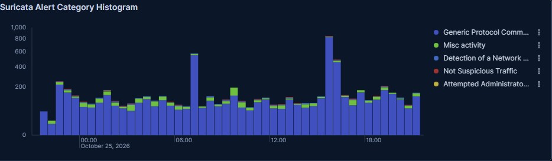

# T-Pot Honeypot Lab

A cloud honeypot deployed on Vultr to observe real-world internet attack traffic, then analyzed with Kibana and Suricata from a SOC analyst's perspective.

**Stack:** Vultr VPS · Ubuntu 26.04 LTS · T-Pot (Mini edition) · Docker · Elastic Stack (Elasticsearch, Logstash, Kibana) · Suricata

\---

## 1\. Goal

Build and secure an internet-facing honeypot, collect real attack data, and practice the analyst workflow: separate background noise from meaningful activity, document findings, and report them clearly.

## 2\. Environment

|Item|Detail|
|-|-|
|Provider|Vultr (cloud VPS)|
|OS|Ubuntu 26.04.1 LTS|
|Resources|8 GB RAM (about 7.2 GiB usable), 150 GB disk|
|Honeypot platform|T-Pot, Mini edition|
|Monitoring|Kibana dashboards, T-Pot Attack Map, Suricata IDS|
|Server Live|24.10.2026 21:30 to 25.10.2026 22:00|
|Internet exposure (ports open)|24.10.2026 22:00 to 25.10.2026 22:00|
|Data captured|25.10.2026 15:45 (about 18 hours after the ports opened)|

**Why the Mini edition:** the standard Hive install lists 16 GB RAM as its requirement and the Sensor edition needs a separate Hive server to send logs to, so Mini was the best fit for an 8 GB single server.

## 3\. Security design

The server is deliberately vulnerable-looking, so the management side was locked down:

* **SSH key authentication** (Ed25519 key pair) instead of password login for the server.
* **Non-root admin user** with sudo for the T-Pot installation.
* **Provider firewall (Vultr firewall group):**

  * Management ports (SSH 64295, web dashboard 64297, install-time SSH 22) restricted to a single trusted IP (/32).
  * Honeypot port range (TCP/UDP 1-64000) opened to the internet only after the management side was verified.
  * Ports above 64000 left closed to the public.
* **Verified listening services** with `ss -tulpn`: honeypots run in Docker, real SSH on 64295, and Kibana, Elasticsearch and Logstash bound to localhost behind an nginx reverse proxy.

* **Isolation:** no personal data, credentials or other infrastructure were stored on or reachable from the server.

**Timeline**

|Time|Event|
|-|-|
|24.10.2026/2130hrs|Server deployed, T-Pot installed, management access verified|
|24.10.2026/2200hrs|Honeypot port range opened to the internet|
|+1 hour|43 events recorded on the Attack Map|
|25.10.2026/1545hrs|Analysis and evidence capture|
|25.10.2026/2200hrs|Server destroyed to stop charges|
## 4\. Data Collection

## 5\. Findings

**Overview**

* **Total events:** 44,346, recorded between the ports opening (24.10.2026 22:00) and the evidence capture (25.10.2026 15:45)
* **Top source countries:** Iran, United States, France, Netherlands, Romania
* **Top targeted services / ports:** SMB 445, SSH 22, RDP 3389, HTTP 80, SQL Server 1433
* **Top source IPs:** 217[.]218[.]34[.]63, 77[.]239[.]124[.]152, 80[.]94[.]95[.]109
* **Top usernames attempted:** hadoop, Administrator, admin, steam, devop
* **Top passwords attempted:** password, demo, 123456, Admin@123, admin123
* **Malware or file download attempts:** none observed in the honeypot and Suricata views I reviewed

### Suricata alerts

* Alerts began shortly after the ports were opened and stayed steady around the clock, which is typical of automated internet-wide scanning.
* The most common category was **Generic Protocol Command Decode**, mostly malformed or unexpected traffic aimed at open ports.
* The top Suricata alerts were protocol anomalies and informational events, consistent with automated scanning.
* SSH was the most visible service in the alerts, through port 22 probing and invalid banners.
* No exploit or malware signatures appeared in the top 10.

## 6. Analysis

* **Noise vs signal:** traffic was spread across many sources with no single source dominating, and the pattern (steady volume around the clock, default credentials, common service ports) points to mass scanners rather than targeted attacks.
* **Credential guessing:** attempts used default and common credentials (`Administrator`, `admin`, `123456`, `admin123`), consistent with automated brute-force tools targeting Windows and generic admin accounts.
* **Service targeting:** the most probed services were SMB (445), SSH (22), RDP (3389) and SQL Server (1433), the usual remote-access and database targets.
* **What did not happen:** no malware downloads or exploit signatures were observed in the capture window.

### Caveats

* Suricata alerts are detections, not confirmed compromises.
* Source country shows where traffic came from, not who is behind it. Proxies, VPNs and compromised hosts are common, so geolocation is not attribution.

## 7\. Lessons learned

* **Firewall scoping mistake:** I first entered the server's IP in the firewall allow-list instead of my own, which caused SSH timeouts. Management rules need the *client's* public IP.
* **Installer failure:** the T-Pot installer failed at its first step because of a rejected sudo password. I diagnosed it from the "Sorry, try again" message in the output and retried.
* **Choosing an edition:** matched the T-Pot edition to the available RAM and avoided the Sensor edition.
* **Browser URL:** reaching the dashboard requires port 64297. Without it the browser lands on a honeypot web service.

## 8\. Next steps

* Write detection ideas based on the observed signatures.
* Try Zeek or Wazuh for comparison.
* Add a short incident-style report for one source IP.

\---

*All IP addresses of my own systems, usernames and credentials have been removed or blurred. Attacker IPs shown come from public internet scanning.*
